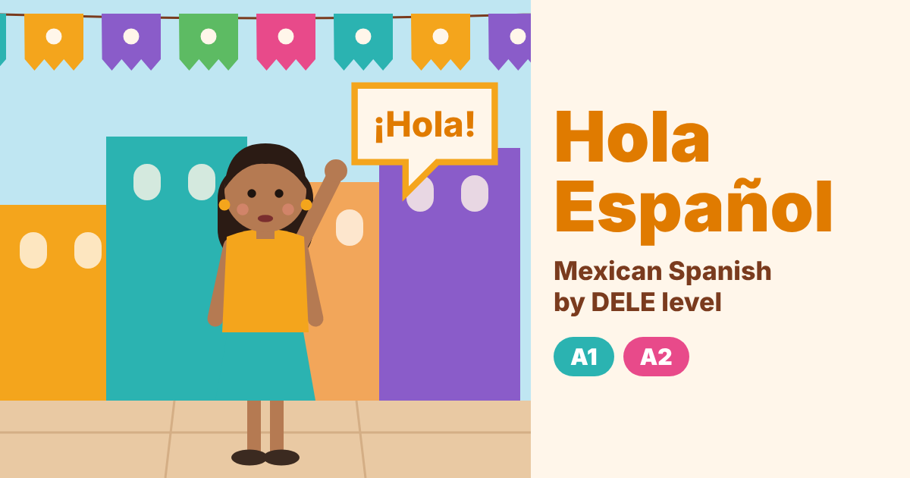

# Hola Español

A personal Mexican Spanish learning app, modeled on the layout and flow of SuperChinese and SuperTest, organized by DELE level instead of HSK level.

## Why I built it

I wanted an app that teaches Latin American / Mexican Spanish the way SuperChinese and SuperTest teach Chinese: level by level, covering the full vocabulary for each level, with friendly illustrated lessons and real exam practice. Nothing like that existed for DELE, so I built my own for personal use.

## Features

- **Levels:** A1 and A2, organized into units and lessons
- **Lessons:** new words with example sentences, picture prompts, listening and multiple-choice questions, matching pairs, and word-tile sentence building
- **Audio:** uses your device's Spanish voice (Mexican Spanish first when available), with words highlighted karaoke-style as they're read, plus a slow mode
- **Speaking practice:** a microphone button on devices that support speech recognition
- **DELE practice:** a DELE-format mock exam for each level, timed like the real exam, plus practice by section (reading, listening, writing, speaking)
- **Review:** missed and starred words, incorrect answers
- **Motivation:** daily goal, streaks, and stars for each lesson
- **Illustrated scenes:** animated cartoon characters set in a Mexican street market style
- **Dark mode**

## How to run it

There's nothing to install. Download the files and open `index.html` in a web browser.

## How it's built

Plain HTML, CSS and JavaScript, with no frameworks, libraries or build step.

| File | What it does |
|---|---|
| `index.html` | Page structure and all styling |
| `app.js` | App logic: lessons, quizzes, audio, progress, exams |
| `art.js` | The illustrated, animated characters and scenes |
| `data.js` to `data4.js` | Course content: units, lessons and vocabulary |
| `exam-a1.js` | The A1 mock exam |
| `exam-a2.js` | The A2 mock exam |
| `thumb.png` | Preview image |

## Notes

- The app was originally built as a Claude artifact. Two features depend on that: the backup voice (used when a device has no Spanish voice) and progress synced to a Claude account. Run anywhere else, the app uses the browser's built-in Spanish voice and saves progress in the browser only.
- The mock exams are practice sets written in the DELE format. They are not official Instituto Cervantes exams.
- This is a personal project for my own study.
